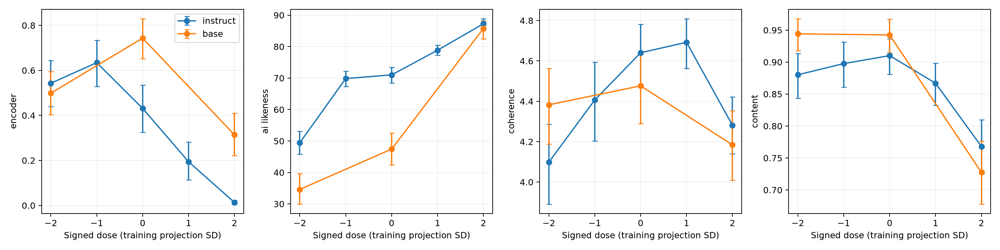
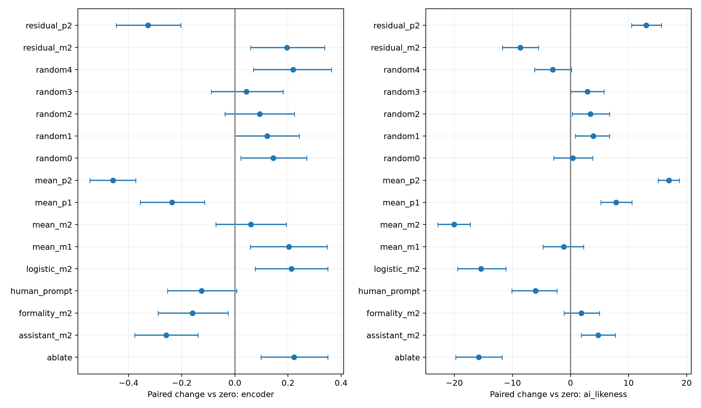
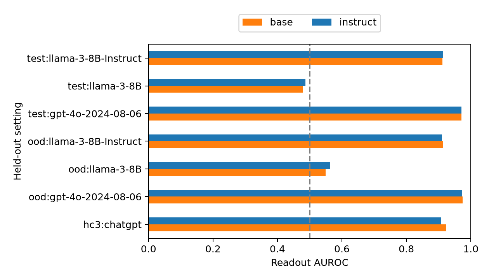

# Is there a “sounds like AI” direction in the residual stream?

Research execution: 2026-10-04. **Outcome: partial causal style control; the stronger distinct, detector-consistent, content-preserving hypothesis was not established.**

## 1. Executive Summary

We tested whether a human/AI readout direction also controls new writing, rather than stopping at probe accuracy. In Qwen2.5-1.5B-Instruct, subtracting a matched-corpus direction at layer 24 lowered a blinded Gemini judge’s AI-likeness rating by **20.04/100 points** (95% paired bootstrap CI −22.85 to −17.27; Holm-adjusted sign-flip p = 0.00020). This exceeded the change under five equal-norm random directions. However, coherence fell **0.591/5 points** (CI −0.754 to −0.427), failing the prespecified preservation margin. A frozen RoBERTa detector did not corroborate the primary improvement: its AI score changed **+0.061** (CI −0.072 to +0.193; adjusted p = 0.381). Positive steering increased judge-rated AI-likeness while sharply *decreasing* the encoder’s score.

The readout was strong in both pretrained base and instruction checkpoints: held-out GPT-4o/human AUROC was **0.9707 vs 0.9704**, respectively. It transferred to Llama-3 instruction outputs (instruction-backbone AUROC 0.913), but not Llama-3 base outputs (0.486). Removing five nuisance directions retained a smaller judge-rated style effect, with continuing quality loss and detector disagreement. These results support a controllable component of instruction-model writing style under this protocol, not a universal representation of machine authorship or a demonstrated separation from the published Assistant Axis.

The study produced **1,472 genuine local-model task outputs**, 288 nuisance outputs, two independent scoring systems, 64 repeated judge ratings, and complete cached artifacts. The practical lesson is that readout transfer, generation controllability, detector validity and preservation of meaning must be tested separately. A lower detector score alone was particularly misleading here.

## 2. Research Question, Motivation and Literature

**Question.** Does a direction fitted to human versus machine text causally alter independent judgments of new generations while preserving content and coherence? Is it separable from length, domain, fluency, formality and assistant persona, and does instruction tuning amplify it?

Quaremba et al. and SV-Detect establish strong representation-based detection, but do not establish generation control. Kuznetsov et al. already steer individual SAE features associated with style; their factual side effects prevent claiming that this is the first causal AI-style intervention. The Assistant Axis concerns persona and is an important alternative explanation. The contribution here is the combined intervention/control/measurement test and its negative findings, not a new detector leaderboard result. The full gathered synthesis and paper-reading record are in [literature_review.md](literature_review.md) and [papers/README.md](papers/README.md).

Three directions were retained before experiments: causal dose response; nuisance distinctness; domain/generator/base–instruct transfer. SAE atlases, evasion optimization, fine-tuning, circuit discovery and multilingual universality were pruned. [planning.md](planning.md) preserves the ranked handoff and frozen feasible protocol, including implementation adjustments.

## 3. Experimental Setup and Methodology

### Models and resources

| Role | Exact checkpoint / revision |
|---|---|
| Steered instruction model | `Qwen/Qwen2.5-1.5B-Instruct`, `989aa7980e4cf806f80c7fef2b1adb7bc71aa306` |
| Paired pretrained model | `Qwen/Qwen2.5-1.5B`, `8faed761d45a263340a0528343f099c05c9a4323` |
| Frozen encoder detector | `Hello-SimpleAI/chatgpt-detector-roberta`, `d2b342c61775d5dd0221808a79983ed3b86ffd86` |
| Blinded style/quality judge | OpenRouter `google/gemini-3.8-flash`; catalog canonical slug `google/gemini-3.8-flash-20260902`; returned provider Google |

These historical 1.5B checkpoints were chosen for a paired mechanistic intervention with accessible internals, not as contemporary capability leaders. No model response was simulated. The live OpenRouter catalog, supported parameters and prices were checked and archived **before** judge selection in [results/live_catalog.json](results/live_catalog.json). API requests used `https://openrouter.ai/api/v1/chat/completions`, default routing, temperature 0, JSON output, and max_tokens 3000. API aliases and provider infrastructure remain mutable despite the catalog snapshot.

Hardware was one NVIDIA RTX A6000 (49,140 MiB). Python 3.12.8, PyTorch 2.14.1+cu130, Transformers 4.57.6, NumPy 2.5.3, scikit-learn 1.9.1 and SciPy 1.18.1 ran in the project `.venv`. Local inference used bfloat16 and SDPA, extraction batches of 32 and generation batches of 16. These conservative batches accommodate the large vocabulary/logit tensors and concurrent checkpoint runs; peak allocated memory was 16.1 GB per process. Instruction and base pipelines took 462.7 and 175.4 seconds, partially overlapping. No training or CPU/GPU timing comparison was performed. Optional native JIT was disabled because the environment lacks a C compiler; the initial failed attempt is logged. Exact dependencies and environment are in `uv.lock` and [results/execution_environment.json](results/execution_environment.json).

### Data, grouping and controls against leakage

We used the pre-gathered HAP-E release, joining human **chunk 2** and generated continuations by source ID. Human chunk 1 was not mislabeled as a comparison response. Academic/blog/news sources were split into **384 training, 96 validation and 128 test documents**; **128** fiction/spoken/TV-movie documents formed a held-out-domain set. Training used only GPT-4o versus human continuations. Test sets additionally contained Llama-3-8B base and instruction continuations. Each four-way test source thus shares its human reference; it is not four independent documents. Another **128 HC3 question pairs** tested task transfer without fitting any direction.

The resulting corpus contains **2,240 texts**. Texts were reduced to the first 128 whitespace-delimited words, then at most 192 model tokens. Source IDs and normalized text hashes were disjoint across folds. A training-vocabulary character-4-gram TF-IDF audit found maximum test-to-training cosine **0.580**, with no cases above 0.90. This does not exclude semantic overlap or pretraining contamination. All exact source IDs, labels, text excerpts and hashes are saved in `results/corpus.json`; data revisions are in the original resource manifests. Length matching is approximate, not guaranteed by truncation.

Generation used **64 distinct fictitious factual records**, eight variants in each of eight community-event topics. Prompts requested a 70–100-word paragraph retaining supplied facts without additional claims. Records specify location, event, day/time, coordinator, an item count, free attendance and a registration deadline. They are test inputs assembled procedurally, not fabricated model behavior. Exact inputs and full prompts are in [results/tasks.json](results/tasks.json) and `results/generations.jsonl`. Their repeated template limits the diversity of the 64 inferential units.

### Extraction, vector fitting and intervention

Raw response text, without chat framing, was passed through each checkpoint. Hooks captured the **last real token after transformer blocks 8, 16 and 24**, one-based, before final normalization. Left padding kept this token at the last position. We fitted a unit AI-minus-human mean direction and an L2 logistic normal (`C=1`, max_iter=2000) directly in native coordinates, with no PCA or scaling inversion. Layer 24 won validation mean-direction AUROC in both checkpoints (0.9811 instruction; 0.9825 base). Generation scores were not used for layer selection.

For a unit vector `v`, addition was `h' = h + α σ v`, where σ is the training standard deviation of projection onto the original mean vector: 18.811 instruction and 19.704 base. We tested α = −2, −1, 0, +1, +2 in the instruction model. The ±2 addition norms were about 23–24% of mean training last-token residual norm. All random and nuisance additions used the **same absolute norm**, not their own projection SD. Ablation was uncentered `h' = h − (h·v)v`, which is not equivalent to negative addition.

The hook changed only the last prompt token predicting the first output and each subsequent cached generation token. Earlier prompt positions were untouched. Arithmetic checks, unchanged earlier positions, zero-hook generation equivalence and repeated sampling smoke tests passed for both models. These checks test the implemented intervention, not the causal validity of the chosen layer.

Conditions comprised zero, four signed mean doses, logistic −2, ablation, five random −2 directions, formality −2, assistant-proxy −2, nuisance-residualized ±2, and the plain “write like a human” prompt. All 17 instruction conditions used seed 42; zero and mean ±2 also used seed 43. The base model ran zero and mean ±2 with seed 42. Sampling was temperature 0.7, top_p 0.9, top_k 0, max_new_tokens 160. Batch seeds were the stated seed plus the starting batch offset. The instruction model used its chat template; the base model used `Instruction: …\nResponse:`. Consequently, generation differences between checkpoints are not a clean isolated tuning effect.

### Nuisance estimation and independent measurements

Each checkpoint generated 24 paired texts for each of formal/casual, verbose/concise and helpful-assistant/fictional-narrator prompts on separate pottery-course records (144 outputs per checkpoint). Greedy generation held supplied facts fixed, but generated realizations could differ in content. Last-token mean differences provided three nuisance proxies. A training activation/length covariance vector and academic-versus-other-domain mean vector supplied two more. QR orthogonalization removed their joint span from the AI direction; the remainder was normalized. **The assistant control is a reduced output-text proxy, not a reproduction of Lu et al.’s multi-role Assistant Axis.**

Two external measures saw only generated text: the frozen RoBERTa detector’s ChatGPT probability and a blinded Gemini style score (0–100). Gemini additionally rated coherence (1–5), source-fact coverage (0–1), and unsupported-claim fraction (0–1). Requests shuffled conditions into batches of eight and replaced all condition/model IDs with opaque integers. The full rubric is in [results/judge_rubric.json](results/judge_rubric.json). Encoder and judge share neither fitted activations nor intervention labels, but statistical independence of their errors is not assumed. We also recorded token/word counts, truncation, repeated trigrams, script-mixing flags and simple anchor recall. Anchor substring recall is only a rough check, not semantic fact verification.

The detector’s model card states that it trained on **all HC3**. Therefore, encoder validity was assessed on **64 held-out HAP-E human/GPT-4o pairs**, not HC3. These 64 IDs were lexicographically selected from the held-out test split and do not represent every domain equally. Judge calibration used the same pairs. A separate 64-output re-rating checked judge reliability under different batching.

### Statistical plan and decision rules

The primary contrast was instruction mean −2 versus zero on both external style scores. Seeds were averaged **within prompt**, then 64 prompts were bootstrapped 5,000 times for percentile 95% intervals. Paired sign-flip tests used 10,000 draws, with Holm correction across the two primary style tests. We report paired standardized effect `dz` and all tested conditions. Sign-flip inference assumes exchangeability/symmetry under the paired null; bootstrap intervals avoid a normal-error model. Ordinal quality scores are treated as numeric rubric averages. Other contrasts are exploratory with unadjusted tests, not additional confirmed discoveries.

Preservation required lower 95% confidence bounds above **−0.25 coherence points** and **−0.05 fact-coverage units**. Failure to establish noninferiority is not automatically proof of damage: the coherence result is clear damage, while some content intervals are inconclusive. Coverage alone also does not rule out invented claims, so unsupported-claim scores remain essential. We report the full curves, then descriptive comparisons restricted to mutually high-quality, matched-coherence outputs; those post-treatment subsets cannot identify an unbiased causal effect. Eight-template cluster resampling, individual-seed results and length-adjusted regression are exploratory robustness checks.

## 4. Results

### Primary intervention and preservation

Values below average the two primary seeds within each of 64 source records. Positive encoder change means *more* machine-like according to that detector.

| Outcome | Zero mean | Mean −2 | Paired change [95% CI] | Holm p / paired dz |
|---|---:|---:|---|---|
| Encoder AI probability | 0.476 | 0.537 | +0.061 [−0.072, +0.193] | 0.381 / +0.112 |
| Judge AI-likeness, 0–100 | 69.219 | 49.180 | −20.039 [−22.852, −17.266] | 0.00020 / −1.728 |
| Coherence, 1–5 | 4.703 | 4.112 | −0.591 [−0.754, −0.427] | exploratory / −0.888 |
| Fact coverage, 0–1 | 0.919 | 0.891 | −0.0279 [−0.0573, +0.0016] | exploratory / −0.229 |
| Unsupported claims, 0–1 | 0.179 | 0.193 | +0.0141 [−0.0137, +0.0422] | exploratory / +0.121 |

Neither quality noninferiority gate passed for the primary intervention. Positive +2 raised judge AI-likeness by **16.93** [15.10, 18.72], but lowered encoder score by **0.459** [−0.545, −0.373], lowered coherence by **0.414**, and lowered fact coverage by **0.131**. The two measures are not interchangeable operationalizations of AI style.

*Figure 1. Seed-42 signed-dose means and prompt-bootstrap 95% intervals; 64 tasks per point. Base has only −2, 0 and +2 observations. Lines connect observed conditions and do not imply tested intermediate base doses. The primary two-seed analysis is in the table above.*

### Controls and distinctness

The table reports paired changes against the **same-seed** zero baseline. Mean ±2 uses both seeds; other conditions use seed 42. Full intervals and unadjusted exploratory tests are in [results/paired_comparisons.csv](results/paired_comparisons.csv).

| Instruction condition | Δ judge AI-likeness | Δ encoder score | Δ coherence | Δ fact coverage |
|---|---:|---:|---:|---:|
| Mean −1 | −1.17 | +0.203 | −0.234 | −0.013 |
| Mean −2 | −20.04 | +0.061 | −0.591 | −0.028 |
| Mean +1 | +7.84 | −0.237 | +0.052 | −0.043 |
| Mean +2 | +16.93 | −0.459 | −0.414 | −0.131 |
| Logistic −2 | −15.39 | +0.214 | −0.570 | −0.039 |
| Projection ablation | −15.78 | +0.223 | −0.233 | −0.002 |
| Random directions, five-condition range | −3.05 to +3.91 | +0.043 to +0.219 | −0.164 to +0.148 | −0.025 to +0.016 |
| Formality −2 | +1.88 | −0.159 | +0.063 | −0.071 |
| Assistant proxy −2 | +4.77 | −0.259 | +0.125 | −0.051 |
| Nuisance-residualized −2 | −8.67 | +0.196 | −0.555 | −0.045 |
| Nuisance-residualized +2 | +13.00 | −0.327 | −0.406 | −0.111 |
| Human-style prompt | −6.02 | −0.126 | −0.094 | −0.024 |

At seed 42, mean −2 reduced the judge score **23.08 points more than the average random direction** (CI −26.44 to −19.55), but cost an additional 0.493 coherence points. Its encoder contrast against the random average was −0.012 [−0.129, +0.107]. Thus, generic perturbation does not explain the large judge effect, but the encoder does not establish a corresponding specific effect. The prompt baseline had a smaller judge change with broad quality intervals; neither preservation gate was established for it at this sample size.

Instruction mean-vector cosine similarities were −0.038 with formality, +0.039 with verbosity, −0.236 with the assistant proxy, −0.231 with length, and +0.072 with domain. Joint removal retained **86.3% of vector norm**. The residualized direction remained readable (GPT-4o test AUROC 0.966) and retained a smaller causal judge effect, but still damaged coherence. This rules out simple collinearity with these particular proxies; it does not establish semantic independence from the underlying constructs.

*Figure 2. Prompt-paired mean changes and 95% bootstrap intervals. Seed counts follow the table above. These intervals are marginal, not simultaneous across all exploratory comparisons.*

### Readout transfer and base versus instruction tuning

| Held-out text setting | Base-backbone mean AUROC | Instruction-backbone mean AUROC |
|---|---:|---:|
| GPT-4o, academic/blog/news | 0.971 | 0.970 |
| Llama-3-8B **base**, same domains | 0.479 | 0.486 |
| Llama-3-8B **instruction**, same domains | 0.912 | 0.913 |
| GPT-4o, held-out domains | 0.975 | 0.973 |
| Llama-3-8B base, held-out domains | 0.549 | 0.564 |
| Llama-3-8B instruction, held-out domains | 0.913 | 0.911 |
| HC3 human/ChatGPT answers | 0.923 | 0.909 |

For instruction-backbone in-domain tests, GPT-4o AUROC CI was **0.950–0.987**, versus **0.423–0.550** for Llama base. The paired instruction-minus-base backbone AUROC difference on GPT-4o was **−0.0003** [−0.0051, +0.0053]. We found no amplification in this separability metric; this is not an equivalence test for every aspect of representation strength. Base-model negative steering changed both scores downward (judge −12.81 [−18.28, −7.03]; encoder −0.244 [−0.365, −0.124]), but its coherence interval, −0.094 [−0.320, +0.133], did not establish the −0.25 noninferiority margin. Base controls beyond signed doses were not run.

*Figure 3. Validation-selected mean-direction test AUROCs; 128 human/machine pairs per generator-setting. Human references are shared within each source set. Bootstrap intervals and logistic alternatives are saved in results/.*

Readout survived a within-pair token-length difference limit of 10: instruction AUROC **0.973** on 64 in-domain pairs and **0.976** on 77 held-out-domain pairs. Training projection correlated −0.075 with token length and −0.313 with model NLL. In-domain GPT-4o negative-NLL AUROC was 0.684, versus mean-direction 0.970. Intriguingly, negative NLL detected Llama base at 0.903 when the mean direction was near chance. These are partial confound checks, not proof of independence from fluency or length.

### Detector validity, reliability and robustness

| Independent measure | HAP-E calibration AUROC [95% CI] | Human mean / GPT-4o mean |
|---|---|---|
| Frozen RoBERTa | 0.656 [0.585, 0.729] | 0.033 / 0.155 |
| Gemini judge | 0.965 [0.930, 0.992] | 17.42 / 58.05 |

The encoder was weak under this domain/generator shift, so its disagreement limits corroboration rather than decisively disproving every style effect. Across all generated outputs, encoder/judge Spearman correlation was **−0.375**. On 64 re-rated outputs, judge AI-likeness agreement was **0.661**, with mean absolute difference **10.78/100**; coherence agreement was 0.850 and mean absolute difference 0.211. No human rating validation was performed.

The negative judge effect appeared at both seeds (−21.56 and −18.52), with coherence losses at both. Resampling eight topic/template clusters retained a judge interval of −22.70 to −17.30 and coherence interval −0.793 to −0.405; eight clusters remain too few for broad population claims. Exploratory post-treatment length adjustment left an approximately −20.45 judge coefficient, which is not an identified direct effect.

Matched-quality analysis retained only **11/64 instruction pairs** for mean −2 at seed 42. It showed judge change −15.45 [−28.64, −1.82], but encoder change +0.301 [−0.032, +0.613]. Only **22 base pairs** passed the same filter, with both scores lower. These small selected subsets cannot establish preservation for the full population; bootstrap and discrete sign-flip inference also differ at these small sample sizes. All subset counts and intervals are in [results/quality_matched.csv](results/quality_matched.csv).

### Error analysis and cost

The primary instruction baseline already contained unsupported claims: average unsupported fraction was 0.179, and only 14.8% of outputs met the requested 70–100-word range. Mean −2 raised the proportion rated below coherence 4 from **5.5% to 21.9%**. Mean +2 produced detected Chinese/Cyrillic-script mixing in **3.9%** of outputs, versus 1.6% at zero, and a 2.3% truncation rate. These flags describe errors and were never used to discard outputs.

For the first library task, the zero output invented an anniversary; mean −2 invented an end time and duration, calling “13:00” noon; mean +2 added ornate promotion and a Chinese ending. This fixed example was not chosen for favorable steering. Other failure classes include unsupported target audiences or refreshments, omitted registration deadlines, exaggerated claims, and awkward quantity descriptions. Full fixed-prompt comparisons and the lowest-rated cases are in `results/paired_examples.json` and `results/failure_examples.json`; all outputs remain available.

There were **208 successful API requests**, including calibration and repeated ratings, consuming **282,947 prompt tokens** and **109,513 completion tokens**. Returned API cost totaled **$0.622884**; no ultimately failed calls were present. Local inference cost is not monetized. Approximate per-condition costs, allocating mixed-batch costs equally among items, are in [results/api_cost_allocation.json](results/api_cost_allocation.json); for example instruction mean −2 was $0.0598 including its share of re-ratings. Full responses and usage are cached without credentials.

## 5. Discussion

The intervention is causally effective on generated wording and on one independent model’s perception of style. Signed doses, zero-hook checks, equal-norm random controls and repeated seeds make a pure readout-only account inadequate for this specific checkpoint and task. Nevertheless, the central **conjunction**—consistent independent detection, content/coherence preservation and distinctness—failed. Direction sign was consistent with the judge but often reversed under the encoder; high doses introduced collateral changes. The result should not be presented as validated detector evasion or as evidence that outputs became human-authored.

The transfer failure on base-generator text is especially informative. A direction that separates GPT-4o from human continuations can resemble an instruction-generation style axis without detecting all machine production. Its presence in a pretrained backbone shows that the representation does not require chat tuning in that backbone, but does not establish an internal explicit belief about authorship. Near-equal base/instruction readout performance provides no evidence of amplification under the tested metric.

Residualization weakens but does not eliminate the judged style effect. Our nuisance measurements are incomplete and partly content-contaminated; removing their span is not a semantic guarantee. The evidence therefore leaves open whether a better layer/vector/model, a richer Assistant Axis estimate, or a lower-dose operating point could yield more selective control. None should be inferred from these data without a new controlled test.

## 6. Limitations and Deviations

- **Restricted models/tasks.** One 1.5B model family, historical checkpoints, 64 templated announcement records, and no human annotators. Base and instruction generation formats differ. Strong conclusions about modern frontier models, free continuation or a universal axis are unsupported.
- **Measurement weakness.** The historical encoder transferred poorly; the current judge had substantial re-rating noise and judged both style and quality. Its provenance discrimination on HAP-E does not validate every subtle treatment comparison. Factual coverage does not exclude invented information.
- **Quality and dose.** Strong interventions were large relative to residual norm. The baseline did not reliably obey length or no-extra-facts instructions. Matched-coherence filtering conditions on treatment outcomes and is descriptive only. Failure of a noninferiority test can reflect insufficient precision.
- **Incomplete distinctness.** The assistant proxy is not the published Assistant Axis; no dedicated fluency intervention, exhaustive persona subspace, crossed persona/style prompt experiment, or full formality manipulation validation was run. Nuisance output pairs may differ in facts. Length/NLL diagnostics do not resolve all confounding.
- **Reduced handoff scope.** The frozen execution appendix reduced the aspirational ≥300 prompts/three seeds/multiple families to 64 prompts, two primary seeds and a paired base checkpoint. No SAE analysis, shuffled-label intervention, full RAID/MAGE stress test, independent likelihood detector, or causal generation test on natural HAP-E continuations was run. Domain/generator transfer here is **readout transfer**, not causal transfer to new tasks. These omissions are not claimed as completed experiments.
- **Inference/reproducibility.** Most contrasts are exploratory; only two primary score tests received Holm correction. Prompt bootstrap assumes records are exchangeable despite common templates; eight-cluster sensitivity is limited. Exact token output may depend on GPU/software versions. API re-ratings are not deterministic; cached analysis is reproducible. Full inference was not rerun twice, but repeated smoke batches and the complete numerical analysis were checked.
- **Contamination/selection.** Source and lexical audits cannot exclude model pretraining contamination. HAP-E itself filters refusals/incomplete text. HC3 is older and stylistically confounded. Calibration was a small lexicographically selected held-out subset. Corpus matching holds prefix/topic, not every proposition, constant.

## 7. Conclusions and Next Steps

A human/AI residual readout direction **can change writing and judge-perceived AI-like style** in this setup. We did **not** establish a distinct, detector-consistent AI-ness direction that preserves coherence and content: the primary steering damaged coherence, the two measures disagreed, and transfer to base-generator text failed.

The next decisive study should retain signed/random/nuisance/prompt controls while using a stronger contemporary paired base/instruction family, diverse naturally grounded writing tasks, human ratings plus a detector validated on current generators, and a genuine multi-role Assistant Axis estimate. Preselect layer/dose on separate quality-aware validation data and test preservation on a larger untouched set. Report nulls and measurement disagreement rather than optimizing the evaluation detector.

## 8. Artifacts and Reproducibility

[README.md](README.md) gives exact commands. Main implementation: `src/prepare.py`, `src/experiment.py`, `src/score.py`, `src/analyze.py`, `src/audit_analysis.py`, `src/supplement.py`, and `src/validate.py`. Configuration is recorded in [results/config.json](results/config.json); full prompts are stored with raw outputs and judge calls. Native activation arrays and vectors are in `results/*.npz`. Environment pins are in `pyproject.toml`/`uv.lock`. Final checks are recorded in [results/validation.json](results/validation.json), including identical repeated numerical-analysis hashes, score completeness, disjoint folds and hook/sampling smoke tests. Generated pipeline sections and resource-finder notes in `STATE.md` were preserved.

## References

1. Quaremba et al. [Linear Probing Provides Robust and Efficient Detection of Machine-Generated Text](https://arxiv.org/abs/2608.24780), 2026.
2. Vishnyakov and Gaintseva. [SV-Detect: AI-generated Text Detection with Steering Vectors](https://arxiv.org/abs/2606.07313), 2026.
3. Kuznetsov et al. [Feature-Level Insights into Artificial Text Detection with Sparse Autoencoders](https://arxiv.org/abs/2503.03601), 2025.
4. Lu et al. [The Assistant Axis](https://www.anthropic.com/research/assistant-axis), 2026; [paper](https://arxiv.org/abs/2601.10387).
5. Rimsky et al. [Steering Llama 2 via Contrastive Activation Addition](https://aclanthology.org/2024.acl-long.828/), 2024. Local CAA and assistant-axis code informed the mean-difference and positional-hook adaptations.
6. Reinhart et al. [Do LLMs write like humans? Variation in grammatical and rhetorical styles](https://arxiv.org/abs/2410.16107); [HAP-E corpus](https://huggingface.co/datasets/browndw/human-ai-parallel-corpus).
7. Guo et al. [HC3 study](https://arxiv.org/abs/2301.07597); [detector model card](https://huggingface.co/Hello-SimpleAI/chatgpt-detector-roberta), documenting all-HC3 training.
8. [Qwen2.5-1.5B-Instruct](https://huggingface.co/Qwen/Qwen2.5-1.5B-Instruct), [base checkpoint](https://huggingface.co/Qwen/Qwen2.5-1.5B), and [live OpenRouter model catalog](https://openrouter.ai/api/v1/models), accessed 2026-10-04.
